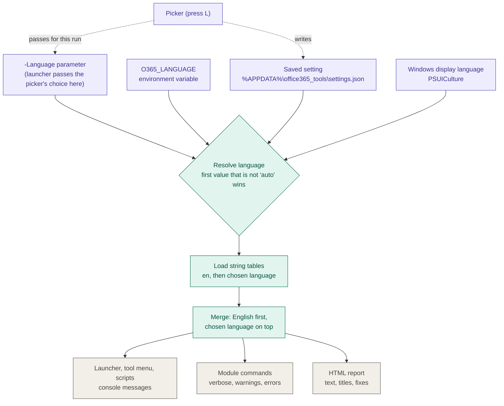

# Multi-language design

> **Status: step 1 of 6 is built** (the loader, the saved setting, the language
> commands and their tests); the rest is planned. Where the implementation
> differs from the design, this document is updated in the same commit. See
> [Rollout](#rollout). The user-facing view is [language.md](../user/language.md).

Every tool in the repository supports **English (`en`) and German (`de`)**. The
language is resolved once per run, before anything is printed, and every
message, prompt and report uses it.

## Goals and non-goals

**Goals**

- One mechanism for the whole repository: module commands, `scripts/`, the tool
  menu and the packaged tools.
- **One saved setting** shared by all of them, so changing the language anywhere
  changes it everywhere.
- Defaults to the Windows display language; can be changed before a run by a
  simple prompt, a parameter, or the saved setting.
- No new dependencies. It must run on Windows PowerShell 5.1, because the
  launcher has to be able to say "PowerShell 7 is missing" on a bare machine.
- A missing translation never breaks anything: English is the fallback, and a
  test makes a missing English text a build failure.
- Adding a language later is adding a folder, not changing code.

**Non-goals**

- Translating identifiers: `RuleId`, command and parameter names, CSV and JSON
  keys. They are contracts other people's scripts depend on.
- Translating data: file names, SharePoint titles, field values.
- Translating text PowerShell or .NET generate themselves (see
  [Known limitations](#known-limitations)).
- Right-to-left layout, plural rules beyond two forms, or locale-specific
  number and date formatting beyond what .NET already does.

## How it fits together



## Language resolution

The language is resolved once per run. An explicit `-Language` value wins. In
the launcher flow the picker's choice is passed on as `-Language`, so it wins
for that run. **`auto` means "continue to the next source"**, and is valid in
every source, including the environment variable.

| Order | Source | Valid values | Notes |
|---|---|---|---|
| 1 | `-Language` parameter | `en`, `de`, `auto` | The launcher passes the picker's result here |
| 2 | `$env:O365_LANGUAGE` | `en`, `de`, `auto` | For CI and unattended runs |
| 3 | Saved setting | `en`, `de`, `auto` | `%APPDATA%\office365_tools\settings.json`, key `language`. Default `auto` |
| 4 | Windows display language | any culture | Mapped as below |
| 5 | `en` | | Last resort |

An invalid value (`-Language fr`) is an error for the parameter, and ignored
with a warning for the environment variable and saved setting, so a typo in a
file never stops a tool from starting.

Optional per-package override: `<Language>` in `upload-check.xml`. It is empty
by default and sits between 1 and 2 only for that tool. It exists for a
locked-down hand-out, not for normal use; the picker never writes it.

### Mapping a culture to a language

```powershell
$two = [System.Globalization.CultureInfo]::new($PSUICulture).TwoLetterISOLanguageName
if ($two -notin (Get-O365SupportedLanguage)) { $two = 'en' }
```

`de-CH`, `de-AT` and `de-DE` all give `de`. Unsupported languages (`fr`, and
tags like `zh-Hans`) give `en`. The culture API is used rather than splitting
the name, so unusual tags are handled by .NET, not by us.

Use `$PSUICulture` (Windows display language), never `$PSCulture` (regional
formats for dates and numbers), otherwise a German-region machine with English
Windows would get German.

The supported list lives in one place, `Get-O365SupportedLanguage`, so the
validation in `-Language` and the picker always agree.

## The saved setting

One file, per Windows user, shared by every tool:

```
%APPDATA%\office365_tools\settings.json
{ "language": "de" }
```

- It lives outside the repository and outside any package. Pulling the repo,
  re-extracting a ZIP or installing a new release never resets it.
- It is read and written by the 5.1 launcher and the PowerShell 7 module alike
  (`ConvertFrom-Json` / `ConvertTo-Json` exist on both).
- Writing is atomic (temp file, then move) and failure is never fatal: the
  choice still applies to the current run and one line says it was not saved.
- A missing or unreadable file is the same as `auto`.
- Unknown keys are preserved on write, so a later setting added by another tool
  is not erased.

The folder name matches the existing `%LOCALAPPDATA%\office365_tools` used for
downloaded releases. Settings go under `%APPDATA%` (roaming) because they are a
preference, not a cache.

## String tables

### Layout

```
src/Office365Tools/Resources/
    en/Strings.psd1          # the reference language; every key exists here
    de/Strings.psd1
packaging/UploadCheck/Resources/
    en/Strings.psd1          # strings only the launcher entry script uses
    de/Strings.psd1
```

Each tool owns the strings only it uses. Folders are named `en` and `de`, not
`en-US` and `de-DE`: the Windows culture is first reduced to a language code
(`de-CH` gives `de`, see above), so a Swiss user finds the German table without
a `de-CH` folder.

### Format

A plain PowerShell data file, one hashtable:

```powershell
# en/Strings.psd1
@{
    'Upload.Menu.Title'       = 'What would you like to do?'
    'Upload.Menu.PreFlight'   = 'Check this folder before I upload it'
    'Upload.Missing.ClientId' = 'No application ID was found. Looked in: {0}.'
}
```

```powershell
# de/Strings.psd1
@{
    'Upload.Menu.Title'       = 'Was möchtest du tun?'
    'Upload.Menu.PreFlight'   = 'Diesen Ordner prüfen, bevor ich ihn hochlade'
    'Upload.Missing.ClientId' = 'Es wurde keine Anwendungs-ID gefunden. Gesucht in: {0}.'
}
```

Rules:

- **Keys** are `Area.Group.Name`, in PascalCase, stable once released. Never
  reuse a key for different text.
- **Placeholders** are positional .NET format items, `{0}`, `{1}`. Never build a
  sentence by concatenating translated pieces: word order differs between
  languages. Both languages must use exactly the same set of placeholders.
- **Files are UTF-8 with BOM.** Windows PowerShell 5.1 reads a BOM-less file as
  the ANSI code page and turns `ö` into `ö`. `.editorconfig` /
  `.gitattributes` enforce it and a test checks it.
- **No logic** in the files. `Import-PowerShellDataFile` reads them in
  restricted language mode, so only literals are allowed.

### Informal German

German text uses the informal address (**du**) throughout, including
imperatives ("Wähle", not "Wählen Sie"). Do not mix in "Sie".

### Loading and merging

`Import-O365StringTable` reads the files with `Import-PowerShellDataFile`
(available on Windows PowerShell 5.1 and PowerShell 7). It was chosen over
`Import-LocalizedData`, which searches culture folders itself and reports an
error for a missing one: here the language is already a plain code, and the
lookup needs to be exact and quiet. It does three steps:

1. Load `en/Strings.psd1`. This is the base.
2. Load the chosen language if its file exists. A missing file is not an error.
3. Merge: start from the English hashtable and overwrite each key present in the
   chosen one.

With several Resources folders (the module's, a tool's) each folder gets the same
treatment in the order given, so a later folder can override an earlier one.

English is therefore always complete underneath. A key that exists only in
English still resolves, and a missing German file falls back cleanly to English.
The merged table is cached for the session.

## API

### Module

| Function | Visibility | Purpose |
|---|---|---|
| `Get-O365String -Key <k> [-FormatArguments <object[]>]` | private | Text for the active language, formatted. See [Missing text](#missing-text) |
| `Get-O365Language` | public | The active language and where it came from. `Source` is one of `Parameter`, `Environment`, `SavedSetting`, `Windows`, `Default` |
| `Set-O365Language -Language en\|de\|auto` | public | Writes the saved setting; supports `-WhatIf` |
| `Get-O365SupportedLanguage` | private, shared | The list of language codes |
| `Resolve-O365Language` | private, shared | Implements the order above. Takes every input as a parameter, so tests can feed it any combination |
| `ConvertTo-O365LanguageCode` | private, shared | Windows culture name to `en` or `de` |
| `Import-O365StringTable` | private, shared | Loads and merges the tables |
| `Format-O365String` | private, shared | Looks a key up in a table and fills in the placeholders |
| `Get-O365SettingsPath` | private, shared | `%APPDATA%\office365_tools\settings.json`; `$env:O365_SETTINGS_PATH` overrides it, for tests |
| `Read-O365Setting`, `Write-O365Setting` | private, shared | The saved setting. `Write-O365Setting` returns `$true` or `$false` and never throws |

"Shared" means defined in `src/Office365Tools/Private/Shared/` (`Language.ps1`, and `ClientId.ps1` for the sign-in application ID), the
one file the launcher dot-sources as well (see below).

`Get-O365Language` returns `Language`, `Source` and `SettingsPath`.

`Source` values are plain identifiers, so scripts can compare them; the console
display may show a friendlier label (`Saved setting`).

Commands gain a `-Language` parameter only where a run produces output for
people (reports, scripts). Plain pipeline commands use the active language and
do not grow a parameter.

The active language is cached for the session in `$script:O365State.Language`,
and the merged table in `$script:O365State.Strings`, so a lookup in a hot loop is
a hashtable read. `-Language` on a command sets it for that command's duration
only and restores it afterwards.

### Call sites

Before:

```powershell
Write-O365Log "Checking names in '$($list.Title)'." 'Info'
throw "Library '$Identity' was not found."
```

After:

```powershell
Write-O365Log (Get-O365String 'Library.Names.Checking' $list.Title) 'Info'
throw (Get-O365String 'Library.NotFound' $Identity)
```

`Write-Verbose` and logs are localised too, because the audience is a person at
a console. Exception types and `FullyQualifiedErrorId` stay English and
constant so code that catches them keeps working.

### Missing text

A missing key is a bug on our side. The design makes it hard to ship and
harmless to the user if it ships anyway.

1. **Prevented** by the key-coverage test (see [Testing](#testing)), which fails
   the build when code uses a key that `en` does not define.
2. **German missing:** the English text is used, silently.
3. **English missing as well:** the user sees a neutral line, "Message
   unavailable (`<Key>`)", never a raw bracketed identifier, and a warning is
   written to the log with the key and the call site, so it can be found.
4. **Report rule text missing:** the title falls back to `Rule <RuleId>`, and the
   fix text to the generic "See the health rules documentation".

The user always sees something readable, and the key is in the log for whoever
has to fix it.

## The tool menu and the launcher (Windows PowerShell 5.1)

The double-click launcher is a one-line `.cmd` that downloads a release and runs
`Start-Tool.ps1`, which shows the tool menu and starts the chosen tool's entry
script (see [packaging/README.md](https://github.com/GBJ-ICT/office365_tools/blob/master/packaging/README.md)). All of that runs
under Windows PowerShell 5.1 before the module or PowerShell 7 is involved, so it
cannot call `Get-O365String` from the module.

**Decided in step 1: one shared loader, no duplication.** The language and string
lookup is one file, `src/Office365Tools/Private/Shared/Language.ps1`. It reads no
module state and takes everything as parameters, so the module dot-sources it
with the rest of `Private/` and the launcher scripts dot-source the same file by
path (`$Root\src\Office365Tools\Private\Shared\Language.ps1`). A release is the
whole repository, so the file is always there, and one implementation means
nothing can drift. The launcher scripts start using it in step 2.

The price is two rules for that one file, both enforced by
`tests/Unit/Language.Tests.ps1`:

- **Windows PowerShell 5.1 syntax only:** no ternary, `??`, `?.`, `&&`, `||` or
  `-Parallel`. The test parses the file and fails on any of them.
- **ASCII only:** 5.1 reads a file without a byte order mark as ANSI, so one
  umlaut in a comment would be read wrongly. The test fails on any byte over 127.

The file was also run by hand under Windows PowerShell 5.1 and PowerShell 7,
including reading the German table with its umlauts.

Messages that the shared file itself raises, such as the error for an unsupported
`-Language`, are English: the file has no table to look them up in.

The `.cmd` itself contains no user-visible text beyond what Windows prints, and
a launcher on someone's machine never changes, so nothing in it is translated.

The language is resolved first, then passed on so the whole chain agrees:

```
Office365-Tools.cmd
  -> Start-Tool.ps1           resolves language, shows the tool menu
       -> Start-UploadCheck.ps1   shows the picker, saves the choice
            -> pwsh Test-Upload.ps1 -Language <resolved> ...
                 -> module commands inherit it
```

### The tool menu

The tool buttons show each tool's `Title` and `Description` from `tool.psd1`
(plain data, English). They become localised by lookup: the menu asks for
`Tool.<Name>.Title` and `Tool.<Name>.Description` in the tool's strings and
falls back to the `tool.psd1` values. `tool.psd1` gains no new fields. The menu
also shows the current language and the same **L** choice, since it is the first
screen a user sees.

### The picker

- Screens that ask a question (the tool menu and "What would you like to do?")
  show `Language: <name>` and an extra choice **L**.
- **L** shows `1) English  2) Deutsch  3) Follow Windows`, then returns to the
  screen in the new language.
- **The choice is remembered.** It is written to the saved setting, so the next
  run, and every other tool, uses it. To try the other language once, press **L**
  again afterwards, or pass `-Language` on the command line.
- If the setting cannot be written, the choice still applies to this run and a
  one-line note says it was not saved. That note appears only on failure.
- Dragging a folder onto the launcher and `-NoPrompt` never show the picker.
- The hint next to the language is always bilingual (`L = change / ändern`), so a
  user who cannot read the current language can still find it.

### Console encoding

The `.cmd` already runs `chcp 65001`. The launcher also sets
`[Console]::OutputEncoding` to UTF-8 so umlauts render. It is not set back: the process ends when the tool does.

## Reports

The HTML report takes its text from the same tables (`Report.*` keys), including
rule titles and "how to fix" paragraphs (`Rule.<RuleId>.Title`,
`Rule.<RuleId>.Fix`). Findings carry only the `RuleId` and data; the text is
looked up when the report is rendered. That keeps findings language-neutral, so
a finding saved as JSON can be rendered later in either language.

The report sets `<html lang="…">` from the resolved language code, not the raw
culture: `de-CH` gives `lang="de"`. The language is also shown in the header.
CSV output never changes.

[health-rules.md](../sandbox/health-rules.md) stays English for now and is the
source of the English `Rule.*` strings. The coverage test keeps the two in step.

## Packaging

The launcher downloads the newest tagged release into
`%LOCALAPPDATA%\office365_tools\vX.Y`, and a release is the repository, so
`Resources/` folders reach users with no packaging change. What does change:

- `READ-ME-FIRST` ships as `READ-ME-FIRST.en.txt` and `READ-ME-FIRST.de.txt`.
  `tool.psd1` keeps `ReadMe` for the English one, and `build.ps1` puts both
  files into the ZIP, so the recipient can open the one they read.
- `upload-check.xml` keeps one set of English comments and gains the optional
  `<Language>` element. A short German header points to `READ-ME-FIRST.de.txt`
  instead of duplicating every setting note.
- `build.ps1` fails when a tool folder has no `Resources/en/Strings.psd1`.

## Testing

All of these run without a tenant, in `build.ps1 -Task Test` and in CI.

| Test | Guards against |
|---|---|
| **Key coverage:** scan all source for message keys passed to `Get-O365String` / the shared loader; every key must exist in `en` | A missing text, the bug that would reach users. Fails the build |
| **Unused keys:** keys in `en` that no code uses are reported | Dead strings accumulating (warning, not failure) |
| Every key in `en` exists in `de`, and the reverse | A missing or stray translation |
| The **set** of placeholders matches between `en` and `de` for every key; `{2}` in `de` when `en` has only `{0}`, `{1}` fails | A German sentence that drops, adds or misplaces an argument |
| Strings files are UTF-8 with BOM and parse as data | The `ö` bug on 5.1 |
| Resolution order, including `de-CH` → `de`, `fr-FR` → `en`, `zh-Hans` → `en`, `auto` in every source, invalid values | Wrong precedence |
| `O365_LANGUAGE=auto` defers to the saved setting, then to Windows | Misreading the environment variable |
| Loader falls back to English for a missing German key, and to the neutral message plus a log warning for a missing English one | Blank, crashing or key-leaking messages |
| Saved setting round-trips, preserves unknown keys, and an unwritable path does not fail the run | Broken persistence |
| Every `RuleId` in the code has `Rule.<id>.Title` and `.Fix` in both languages | A new rule shipped untranslated |
| PSScriptAnalyzer custom rule: no bare string literal passed to `Write-Host`, `Write-Warning` or `throw` in localised files | New hard-coded English creeping back |
| Report renders `lang` from the resolved code and identical `RuleId`s in both languages | Translation altering identifiers |

## Adding a string

1. Add the key and English text to `en/Strings.psd1`.
2. Add the German text to `de/Strings.psd1`. The parity test fails until you do.
3. Use `Get-O365String` at the call site. The coverage test fails if the key
   is mistyped.

## Adding a language

1. Add its code to `Get-O365SupportedLanguage`.
2. Copy `en/Strings.psd1` to `<code>/Strings.psd1` in every `Resources/` folder
   and translate. The parity test shows what is left.
3. Add a `READ-ME-FIRST.<code>.txt`.
4. Add the language name to the picker strings.

No other code changes.

## Known limitations

- **Identifiers stay English:** `RuleId`, command and parameter names, CSV and
  JSON keys. This is deliberate.
- **Framework text stays in the Windows language or English:** PowerShell's own
  parameter-validation and binding errors, .NET exception messages and PnP
  error text are not routed through our tables.
- **Data is not translated:** file names, SharePoint titles and field values.
- **`health-rules.md` is English only**, for now. The report text is translated.
- **Only `en` and `de`** are supported; any other Windows language shows English.
- **Windows 5.1 and encoding:** strings files must keep their BOM. A tool that
  strips it (some editors, some git settings) breaks umlauts; the encoding test
  catches this.

## Rollout

Each step is its own commit and leaves the repository working. Call sites not
yet converted keep their English text until their turn.

1. **Done.** Loader and saved setting, resolution, `Get-O365Language` /
   `Set-O365Language`, tests including key coverage. The shared loader was
   chosen over a duplicated one.
2. Tool menu and `Start-UploadCheck.ps1`: picker, optional `<Language>`, all
   their messages in both languages. The `ClientId` fallback (environment
   variable, then profile) lands in this step so its new messages are born
   translated. It is done in three parts:
   - **2a, done:** the launcher script loads the shared files, resolves the
     language (`-Language` or `<Language>` in `upload-check.xml`, then the
     shared order), reads its texts from `packaging/UploadCheck/Resources/`, and
     looks for the application ID in `<ClientId>`, then `gbj_client_id`, then the
     default profile. Only the messages about signing in are translated so far.
   - **2b:** every other message of `Start-UploadCheck.ps1`, and the **L** picker.
   - **2c:** the tool menu window in `Start-Tool.ps1`.
3. `scripts/Test-Upload.ps1` console output and `-Language`.
4. Module commands, by group: connection, library, permissions, content types,
   document sets, reports.
5. HTML report text, rule titles and fixes.
6. Documentation, German READ-ME, packaging.

## Decisions

| Decision | Choice | Alternative considered |
|---|---|---|
| Mechanism | `Import-LocalizedData` with `.psd1` | gettext/`.po` and `.resx`: a build step or a dependency for what are a few hundred short strings |
| Folder names | `en`, `de` | `en-US`, `de-DE`: would need a `de-CH` folder for Swiss users |
| Fallback | English merged underneath | Error on a missing key: worse for a hand-out tool |
| Saved setting | **One** per-user file, `%APPDATA%\office365_tools\settings.json`, used by launcher and module | A setting per tool (`upload-check.xml`, `config/settings.json`): two sources of truth, and a package update could reset it |
| Picker | The choice is remembered | Per run only, or two choices: more keystrokes, or more UI |
| Launcher strings | One shared loader file, held to 5.1 syntax and ASCII by a test | A duplicated copy in the launcher, kept equal by a parity test: more code and a drift risk; loading the module on 5.1 defeats its purpose |
| Findings | Language-neutral objects, text added at render | Translating at creation: saved findings could not be re-rendered |
| Missing text | Fail the build; neutral line plus log warning at runtime | Showing the raw key: exposes internal names to users |
| Culture mapping | `CultureInfo.TwoLetterISOLanguageName`, validated against the supported list | Splitting the culture name on `-` |
| German address | Informal *du* | Formal *Sie*: matches Windows menus, but stiff for an internal tool |

## Open points

- Whether `settings.json` should also hold other personal preferences later
  (default profile, output folder). If so it gets a schema like
  `profiles.schema.json` from the start.
- Whether `health-rules.md` itself should be translated, or only the report
  text.
