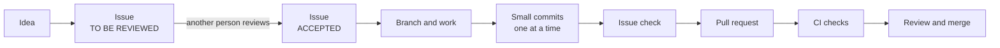

# Contribution workflow

How a change goes from an idea to a merged pull request, and the three Claude
skills that help at each step. The same steps apply when you work without
Claude; the skills only make them quicker and keep them uniform.

The Git rules that always apply are in [CLAUDE.md](https://github.com/GBJ-ICT/office365_tools/blob/master/CLAUDE.md).
How to write a command is in [CONTRIBUTING.md](https://github.com/GBJ-ICT/office365_tools/blob/master/CONTRIBUTING.md).

## The path of a change



### 1. Write an issue

Every change starts with an issue in the fixed structure: **Issue Prompt**,
Overall Goal, Context, **Requirements and Verification Tests** (one table),
Out of Scope, Technical Specification, Open Questions and Tasks.

- The **Issue Prompt** is the request copied word for word, so a reviewer can
  see where the rest of the issue drifted from what was asked.
- Each requirement has its own test and expected behaviour in the same row. The
  issue is done when every test passes. The five test types (Unit, Integration,
  Static, Smoke, Manual) are defined in [Testing](testing.md).
- A new issue gets the label **TO BE REVIEWED**.

### 2. Have someone else review it

A person other than the author reads the description and either asks for
changes or sets the label **ACCEPTED** (and removes TO BE REVIEWED). An issue
carries one of the two labels, never both. Start work on an accepted issue.

The author's own approval does not count. This rule is kept by convention for
now; nothing on GitHub enforces it.

### 3. Work on a branch

Create a branch from the right base and make the change. Add the tests the
issue asks for, the German and English texts for every user-visible message, and
the documentation, in the same change.

### 4. Commit in small steps

Every commit has to pass the pipelines on its own, so it contains the
implementation, tests, texts and documentation it needs together. Locally, the
pipelines are:

```powershell
./build.ps1              # the analyzer and the unit tests
mkdocs build --strict    # when the documentation changed
```

Commits are proposed one at a time, with the message and the file list, and made
only after approval. Commit messages have a short imperative subject line, a
blank line and a body in plain prose.

### 5. Check the work against the issue

Before the pull request, go through the requirements table: run each test that
can be run, write a missing Unit or Static test, and list the Manual tests for
a person. The result goes into the pull request as a status table.

### 6. Open the pull request

The description summarises the change, shows the status table and says what was
not verified. It says `Closes #N` only if every requirement passed, otherwise
`Part of #N` and the open rows.

### 7. Read the pipeline

GitHub Actions runs `.github/workflows/ci.yml` (analyzer, unit tests, manifest
check) and `.github/workflows/docs.yml` (documentation build) on the pull
request. A red check is diagnosed from its log, reproduced locally and fixed
with a new commit.

## The skills

The skills live in `.claude/skills/`. Claude Code loads them by itself when your
request matches, or you can name one ("wrap up this branch"). Each one stops and
asks before anything outward-facing: a commit, a push, a pull request, a label.

| Skill | Use it to | What it does |
|---|---|---|
| `create-issue` | Turn a request into an issue | Writes the issue in the fixed structure, copies your prompt into **Issue Prompt**, labels it **TO BE REVIEWED**, and sets **ACCEPTED** only when a person other than the author accepts it. |
| `branch-wrap-up` | Finish a branch | Plans small commits, stages each one for your review, runs the pipelines on the staged state, commits after your approval, checks the work against the issue, and offers the pull request. |
| `pipeline-monitoring` | Read CI after a pull request | Reads the GitHub Actions result, and for a failed job finds the cause in the log, reproduces it locally and proposes a fix. It does not poll. |

The usual order is `create-issue`, then your work, then `branch-wrap-up`, then
`pipeline-monitoring`.

## Notes

- The labels **TO BE REVIEWED** and **ACCEPTED** must exist in the repository
  before the first issue uses them; `create-issue` asks before creating them.
- The skills use the GitHub CLI (`gh`), which has to be installed and logged in
  (`gh auth status`).
- Nothing is pushed or changed on GitHub without your approval in the
  conversation.
